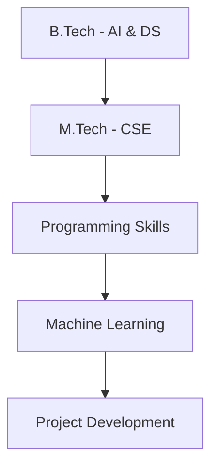

# 👋 Hi, I'm Priyanka!

### 🎓 M.Tech Computer Science Engineering Student
💻 Python | AI | Machine Learning

## 👩‍💻 About Me
- 🎓 Pursuing M.Tech in Computer Science Engineering.
- 🎓 B.Tech in Artificial Intelligence and Data Science.
- 💡 Interested in Artificial Intelligence and Software Development.
- 🌱 Always learning new technologies.

## 🎯 My Learning Journey

## 🛠️ Technical Skills

| Category | Skills |
|---|---|
| Programming | C, Python |
| Database | SQL |
| Web | HTML, CSS |
| Concepts | AI, ML |

## 📂 My Projects

1. Fake Image Detection Using CNN
2. Smart Irrigation and Plant Monitoring System
3. Student Performance Prediction

## 🚀 My Career Roadmap

## 🌟 Areas of Interest

- Artificial Intelligence
- Machine Learning
- Software Development
- Internet of Things

## 📫 Connect With Me

- GitHub: https://github.com/YOUR_USERNAME

---
⭐ Thanks for visiting my profile!
